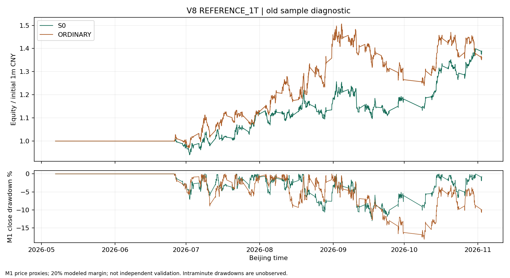
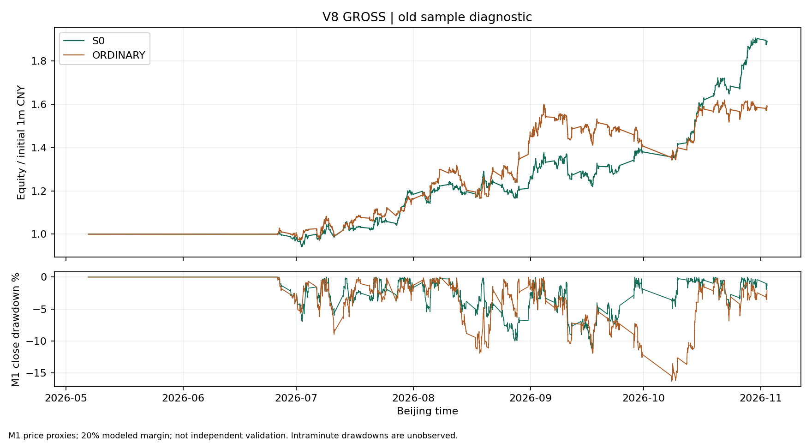

# V8：S0 对简单入场的完整交易回测

> 本文保留 da7a664 初版结论；派生结果链接已固定到修前副本。成交日复核修正后的当前结果见[报告30](30_V8_成交日合约校正与独立回测准入.md)，不要把本文旧数字与当前顶层reports混用。

本轮交付以 `reports/v8_decision_table.csv` 和四份 `v8_*_summary.json` 为机器依据，使用旧180日缓存做诊断。真实下单关闭；没有给 V7.1 首次筛选器补考，也没有打开正式90日样本。结论和完整数值见下文的最终结果部分。

## 实验边界

基线 `a091826`；在任何交易结果计算前，以 `aa56d7d` 提交 [实验登记](../tools/full_trade_v8/registration.json)，以 `6857476` 冻结 [成本假设](../tools/full_trade_v8/cost_reference.json)。只比较两组，不追加第三个入场变体。成本采用用户接受的参考情景，不把它称为经过统计的市场平均费率。

- S0：冻结的方向与 A/B/C/D 技术入场；实际成交后才占用证据、更新冷却和持仓。依赖持仓数量的 Path C 重新按当时已闭合资料计算。
- ORDINARY：同一方向、锚点、结构止损、资金和退出规则。每根合法闭合 M15 尝试入场，替换技术形态与 H1/动能入场过滤；沿用 D 的加仓和冷却后置约束。不是提前知道行情结果的匹配时刻。
- 两组各从100万元独立逐分钟运行。每笔按权益1%预算并留风险缓冲；最多5仓、单品种2仓、簇内2仓；组合/品种当日损失加开放风险上限6%/2%；按前20个完整交易日均量的0.1%限制手数。
- 保证金统一按名义金额20%建模，总占用不超过扣除新仓费用与即时滑点损失后权益的80%。这不是逐合约历史保证金表。
- 信号闭合后，下一合法实际合约 M1 开盘价作为成交代理；止损价在信号时固定，目标按实际入场价的2R重算。开盘已越过止损就取消，缺开仓分钟也取消。当前分钟的高低价、成交量不反向决定其开盘是否成交。
- 已知趋势退出与开盘跳空先处理；随后开仓与资金预留；再处理分钟内止损止盈。双触按止损先达。分钟内盈利不能资助更早的同分钟开仓。止损穿价按下一开盘而非理想止损价记账。
- 换月按现配置持有旧腿，持旧腿时禁止本品种新腿开仓，旧腿继续计算趋势退出。期末未平仓单列估值，不造一笔收盘成交。

这是**逐实际合约、未复权原价事实流**上的当前实现诊断；换月后实际合约要重新满足预热。它不是复权主连策略的等价收益证明。主力历史映射与资料到达时间未知的部分仍为研究假设，不能据此证明当时可得。

## 数据范围和工程修正

名义缓存窗口为2026-05-07至11-02，27条实际合约、12品种。两组共用同一覆盖锁：每腿先满足1,200根连续完整 M15，真实缺分钟后重置开仓资格；持仓跨缺口须按下一可见开盘退出并标记，不能清零亏损。

旧代理日历错误包含6月18日、9月24日、9月30日的节前夜盘。按独立休市通知仅在 V8 副本移除这些预期分钟，未补造行情，原 V6/V7.1 文件不变。来源与修正时点见 [日历修正登记](../tools/full_trade_v8/calendar_corrections.json)。

首次工程草稿发现旧数据在切换主力后就截断旧腿，使部分头寸长期使用陈旧估值并占住仓位。该草稿不可评价策略，留在本机审计目录。随后对所有截断腿统一查询 GM 至11月2日，不按盈亏挑选补数。所有原始 M1 前缀及原事实行逐行保持一致；延长腿逐腿核对原缓存末20根趋势状态和确认标记，再续算旧腿退出。新增尾段永不扩大主用腿入场范围。完整性及哈希见 [尾段原价保全](../reports/v8_baseline_da7a664/v8_tail_fetch.json)、[原前缀与新增事实审计](../reports/v8_baseline_da7a664/v8_tail_integrity.json)、[逐腿趋势一致性](../reports/v8_baseline_da7a664/v8_tail_parity.json)。

工程复核另纠正了三项执行问题：删除利用入场分钟最终量价筛掉开盘成交的前视过滤；新仓手数同时受剩余当日风险额度约束；保证金按原始开盘估值，并预留开仓费用和即时滑点损失。它们修正记账和时间口径，不改变趋势、形态、阈值或新增候选规则。[原登记的执行修订](../tools/full_trade_v8/execution_amendments.json)保留说明；本文明确补充风险与保证金修复。所有最终结果使用同一修正执行版本，前述草稿不参与结论。

逐品种有效范围见 [覆盖表](../reports/v8_baseline_da7a664/v8_product_coverage.csv)，逐腿见 [覆盖锁](../reports/v8_baseline_da7a664/v8_coverage_lock.json)。覆盖不完整的品种与阶段不会被当作180日全覆盖；不可由被排除的期间推断策略收益。

## 成本口径

主情景为固定品种参考手续费加每边1元/手佣金、每边1 tick滑点；压力情景每边2/3 tick。开仓、平仓、平今按交易日区分。四个情景各自重新运行资金、仓位与成交，不能从毛结果简单减同一个费用常数；滑点会改变目标价格、后续持仓与交易集合。

参考手续费逐品种参数见 [cost_reference.json](../tools/full_trade_v8/cost_reference.json)。金额比例按报价×合约乘数计算；鸡蛋的报价换算乘数为10，不能直接用合约吨数5代替。

本轮核对了 [东方财富期货公司标准表](https://portal.eastmoneyfutures.com/pages/service/sxf.html) 的按手/按金额及平今口径；该页为公司不高于标准，并不是本账户价格或市场平均，未将其除以某个倍数冒充交易所核验值。[上期所收费入口](https://www.shfe.com.cn/reports/businessdata/feeandcharges/)和[广期所手续费公告原址](https://www.gfex.com.cn/gfex/tzts/202607/c978c6fc43cf4c2bbd689af19d6b3b1c.shtml)已登记；后者本轮直接获取超时，能查到[会员转载的原通知](https://www.citicsf.com/e-futures/content/000509/823961)，其合约和生效日限制不能外推为整个研究期费率。

逐历史合约费率变更、真实账户加收、盘口成交滑点和逐日保证金尚未完整核验。因此本文的“参考净结果”仅指这些明确假设下的模型结果，不是经认证的历史账户净收益。极端行情、涨跌停排队及逐笔可成交性没有被 M1 OHLC 证明。

## 交付和复算

- [总决策表](../reports/v8_baseline_da7a664/v8_decision_table.csv)、[逐月贡献](../reports/v8_baseline_da7a664/v8_monthly.csv)、[利润集中度](../reports/v8_baseline_da7a664/v8_concentration.json)。
- 四个情景 `reports/v8_{GROSS,REFERENCE_1T,REFERENCE_2T,REFERENCE_3T}_{S0,ORDINARY}_{trades,opened,events,daily_equity}.csv`：逐笔、期末持仓、开仓风险预算和每日权益。
- [原价与事实指纹](../reports/v8_baseline_da7a664/v8_input_manifest.json)、[逐账户资金与风险核验](../reports/v8_baseline_da7a664/v8_ledger_checks.json)。完整原始 M1、授权响应、缓存 pickle 及逐分钟权益曲线仅在本机 `data/cache/full_trade_v8_*`。
- [52项回归及原件复核](../reports/v8_baseline_da7a664/v8_review_checks.json)、[本轮公开交付隐私检查](../reports/v8_baseline_da7a664/v8_privacy_check.json)。
- 本轮按 `production-code-review` 检查实际离线路径：闭合事实→入场意图→下一 M1 `Account.enter`→资金与手数→`Account.close`/期末持仓→账本守恒。未经过 broker 下单接口，没有将离线检查写成生产就绪。

本机运行方式（沿用当前项目 Python）：

```powershell
python -m pytest tests/test_full_trade_v8.py tests/test_entry_risk_execution.py tests/test_backtest_execution.py tests/test_core_step_parity.py tests/test_v3_entry_h1.py tests/test_trend_exit_closes_positions.py -q
python -m tools.full_trade_v8.run --inputs data/cache/full_trade_v8_complete_inputs --output data/cache/new_unique_run --scenario GROSS
```

输出目录必须新建，不能覆盖既有本机审计批次。`run` 会核对输入和冻结代码指纹、拒绝运行期间源码变动，并核对期末权益＝初始资金＋已平净损益＋未平损益减已付开仓费。

<!-- FINAL_RESULTS -->

## 最终结果与裁决

**保留冻结 S0 供下一次不重叠样本验证；本轮没有支持用简单入场替换 S0 的证据。暂缓模拟盘，不继续在旧窗挑选入场参数。** 毛结果与参考主成本情景均为正，但它们来自不完整覆盖的旧研究窗，不能代替独立验证。主情景两组期末权益差仅2.88万元，不能称为统计显著优势。

以下金额含期末未平估值，单位万元；回撤为全量 M1 收盘权益峰谷，未观察分钟内最深回撤。

| 情景 | S0已平笔数 | S0期末损益 | S0最大回撤 | 对照已平笔数 | 对照期末损益 | 对照最大回撤 |
|---|---:|---:|---:|---:|---:|---:|
| 无费用、无滑点 | 457 | +89.21 | 11.76% | 573 | +59.20 | 16.37% |
| 参考手续费＋每边1 tick，主情景 | 440 | +38.98 | 13.00% | 566 | +36.10 | 18.15% |
| 参考手续费＋每边2 tick | 413 | +29.80 | 15.31% | 569 | −14.47 | 28.42% |
| 参考手续费＋每边3 tick | 400 | +5.59 | 22.68% | 536 | −24.39 | 31.33% |

| 每笔及成本容量 | S0 | 简单入场 |
|---|---:|---:|
| 无成本平均毛 R | +0.1880 | +0.1350 |
| 无成本最长连亏 | 11 | 17 |
| 无成本已平平均利润，即静态全成本临界值 | 1,930.83元/笔 | 1,011.08元/笔 |
| 无成本账本等价每边 tick 容量，尚未扣手续费 | 3.62 | 1.76 |
| 主情景平均净 R | +0.0956 | +0.0556 |
| 主情景最长连亏 | 11 | 17 |
| 主情景已平手续费总额 | 60,991.30元 | 82,586.69元 |
| 主情景已平净利润 | 381,698.70元 | 353,083.31元 |
| 主情景期末未平估值，已扣已付开仓费 | +8,075.62元，3仓 | +7,913.49元，5仓 |

静态成本临界值是固定毛账本的算术容量，不是可保证的真实盈亏平衡报价；实际成本情景会改变整数手数、资金竞争、止盈价和交易集合。3 tick 下，S0 平均每笔净 R 已为 **−0.0384**，尽管按动态手数计的总模型损益仍为正。这种差异说明不能只看期末权益。微小手数/额度差异也可改变后续仓位路径；严格保证金修复后主情景对照利润明显变化，初步数字已作废，不以其较大组间差异宣传择时效果。

### 赚在哪里，亏在哪里

主情景 S0 的普通止盈与跳空止盈合计贡献约215.63万元，普通止损与穿价止损合计约−164.49万元，趋势退出约−12.97万元。对应对照为约259.64万元、−209.79万元、−14.54万元。技术筛选减少交易次数和亏损笔数，但这些归因不是“删除某条退出就能增加对应利润”的反事实结论。

主情景 S0 的 PVC 已平净利润20.57万元，占总已平利润约53.9%；剔除 PVC 仍为 **+17.60万元**，剔除最大5笔盈利仍为 **+25.92万元**。简单入场 PVC 贡献34.30万元，占约97.1%；剔除 PVC 只余 **+1.01万元**。S0 有8个有已平交易品种为正、2个为负；不得将无成交品种算作胜出。

时间上，S0 主情景10月已平净利润约19.70万元，贡献约51.6%。9月约0.34万元，6月约−2.20万元。优势并非稳定地按月复制。3 tick 压力下，S0 剔除 PVC 后为 **−8.22万元**，剔除最大5笔后为 **−6.74万元**，因此不能把压力情景总额微正解释为充足成本余量。

主情景各组有1笔开盘分钟单一价格或零成交的不确定代理成交：S0 净利润19,264元、对照23,478元；从固定账本扣除此笔，两组仍为正，但这不是取消该笔后整段资金路径重跑。全部最终账本均无跨缺分钟的已平头寸、无期末未解决缺口、无陈旧期末估值；跳空仍然带来超过1R的损失，毛账本最差单笔为−5.4R。1%计划止损预算绝不代表实际最大亏损仅1%。双触按止损优先，逐笔可检索 `double_touch`。

### 有效样本及继续条件

**不能称为12品种180日完整收益。** 首笔交易直到6月26日才出现；有效开仓 M15 数分别为：CF645、CJ11、SA944、SR1275、EG648、JD142、LH174、M1085、V1552、LC0、AG3126、AU1403。JD/LH有效范围仅覆盖9月至10月的一段，AU后段没有开仓资格。CJ几乎未被研究、LC完全未被研究。图中的早期平线主要是预热与覆盖约束，不能算稳定无回撤能力。

原 V7 的逐机会首触劣势仍成立；本轮说明持仓、资金竞争、退出和机会去重后，不能将那个统计直接换算为可成交组合的负期望。反过来，本轮总盈利也不能推翻逐机会结果，或证明技术条件在新行情中有效。

下一笔研究投入只做一件事：冻结当前完整交易引擎与两组定义，在**未参与选型的不重叠行情**上复验完整交易的成本、集中度和回撤。先登记回撤预算和样本范围，再看结果。当前不改 H1、止损、趋势退出、M5 时钟，也不因本轮 PVC 获利就删除其他品种。正式模拟盘仍需独立样本与执行恢复验收，现阶段不推进。





### 验收回执

本轮 **52项定向测试全部通过**，含13项新引擎回归，以及原始入场风控、执行、core一致性、H1方向语义和趋势退出。52项中包含这13项，不能相加成65项。另通过8账户实际账本的资金守恒、开仓后保证金、剩余风险、最多5仓和期末估值检查；27腿原价/事实前缀保持不变，15条延长腿各核对20根原趋势输出，共300根。

`git diff --check` 通过；冻结策略核心、配置、V7/V7.1 与正式90日协议未修改。本轮实际调用 GM 仅查询历史行情，未扩大实时订阅、未下单、未评分 V7.1、未 seal、未改变签批。测试中出现既有 protobuf UTC 弃用警告，不影响通过；没有宣称已验证真实盘口成交、断线恢复或生产持仓恢复。
