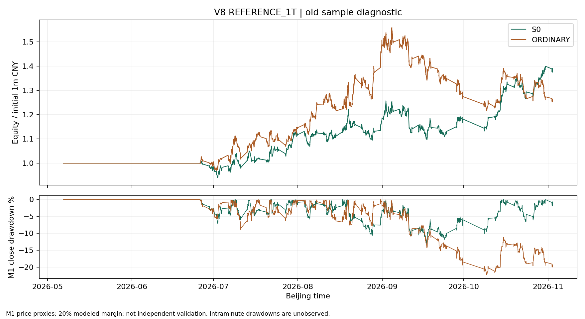

# V8复核：成交日合约校正与独立回测准入

**旧账修正完成；S0继续保留、模拟盘暂缓。独立回测规则和15%回撤预算已冻结，但真实独立回放尚未启动，状态为 `NOT_RUN_SOURCE_BLOCKED`。** 未把数据缺失写成空回放成功，也没有消耗唯一一次独立检验。

基线 `da7a664a136c8211f407765f5883a4bc0e35df71`；按用户提供任务包核对并应用最小成交补丁，提交 **`cb3fd63`**。独立规则在任何独立盈亏计算之前以 **`1edd43b`** 提交。本轮不改趋势、入场形态、风险预算、费用、滑点、退出或样本覆盖参数。

## 1．修复及防复发证据

缺陷：`decide` 在已闭合 M15 检查信号资格，`pending` 跨休市留到下一交易日；`enter` 没再检查这一天的主用实际合约。补录旧腿的持仓管理行情因而可能成为新开仓行情。

最终闸门位于 `Account.enter` 的第一步：

```python
if leg['selection'].get(day) != leg['symbol']:
    self.blocks['ENTRY_LEG_NOT_SELECTED_AT_FILL'] += 1
    return
```

`day` 来自成交 M1 对应的独立日历 `daymap`，不是信号日或本机自然日；`selection` 是原输入已冻结的每日真实合约映射。换腿或无映射均拒绝新仓，不写 `used`、`last_fill` 或资金。已有旧腿仍进入原来的止损、目标、趋势退出路径，不能用开仓资格挡住平仓。

先只应用测试，任务包4个多组/缺映射反例全部红灯；应用引擎补丁后通过。另增4个“换腿或缺映射仍允许已有旧腿趋势退出”用例。本机完成原有52项＋新增8项＝**60项**；再加报价计算3项，共 **63项定向检查通过**，包括本机GM SDK依赖用例。63中已含60，不能重复相加。

按 `production-code-review` 追踪实际离线执行链：闭合信号→跨交易日待执行意图→成交日实际合约复核→资金/风险→账本→旧腿退出。没有调用真实账户下单接口。错误教训是：**信号阶段的合约资格不能替代成交阶段的资格；新开闸门与旧仓退出必须分开。**

## 2．同输入八账户完整复跑

输入锁与 `prepared.pkl` 复用原批次，逐个核对原价和事实SHA256；没有重新导出、补价或改样本。独立工作树需将原输入锁引用的相对路径副本放在相同目录结构；首次路径预检失败发生在交易回放前，补齐同哈希副本后再启动。没有改写输入锁绕过检查。

[八账户比较表](../reports/v8_roll_comparison.csv)及[机器回执](../reports/v8_roll_comparison.json)确认：

- 原八账本只发现1笔成交日未选中且在补录尾段新开的交易，正是 ORDINARY 主情景第79笔 `SHFE.ag2608`。
- 修后八账本中，**补录尾段新开仓为0，成交日未选中/缺映射新开仓为0**；八份资金账均对平。
- 主情景 S0、ORDINARY 各有7笔原持仓在旧腿延长区间或退出日已非主用时继续退出，证明补丁没有禁止旧腿管理。
- S0四个情景及其完整 M1 权益路径均不变；简单入场只有1 tick主情景发生变化，其余三个情景完整权益路径不变。

下表为含期末未平估值的模型损益，单位万元。

| 情景 | S0修前→修后 | 对照修前→修后 | 对照损益变化 | 修后最大回撤：S0 / 对照 |
|---|---:|---:|---:|---:|
| 无成本 | 89.21→89.21 | 59.20→59.20 | 0 | 11.76% / 16.37% |
| 参考费用＋每边1 tick | 38.98→38.98 | 36.10→26.13 | **−9.97** | **13.00% / 22.27%** |
| 参考费用＋每边2 tick | 29.80→29.80 | −14.47→−14.47 | 0 | 15.31% / 28.42% |
| 参考费用＋每边3 tick | 5.59→5.59 | −24.39→−24.39 | 0 | 22.68% / 31.33% |

主情景对照已平笔数从566变成578；最终权益减少 **99,693.65元**。被删除的一笔模型净利只有 **17,975.89元**。不能用单笔扣减代替复跑：按稳定的“合约/方向/开仓时刻”键比较，134个旧持仓身份消失、146个新增，部分共有身份的手数/退出亦改变；最大 M1 权益差曾达到115,961.50元。[逐身份差异](../reports/v8_roll_changed_positions.csv)、[逐日资金曲线差异](../reports/v8_roll_equity_differences.csv)均可复核。

修后主情景 S0 平均每笔模型净R为 **+0.0956R**，对照 **+0.0226R**。S0在2 tick下仍只有 **+0.0079R**，3 tick下 **−0.0384R**。新登记预算15%不会被追溯当成旧窗验收门槛，但旧窗2 tick的15.31%回撤提醒：独立验证必须同时看成本和回撤，不能只看总钱数。

### 主情景差额重算

| S0减对照的修后账本恒等式 | 金额 |
|---|---:|
| 已计滑点、未扣手续费的已平损益差 | +103,620.00元 |
| 少付的参考手续费 | +21,983.76元 |
| 未平净估值差，含已付开仓费 | +2,867.42元 |
| 期末权益差 | **+128,471.18元** |

手续费差占修后权益差约17.1%，原评审的75%只适用于修前账本。这里仍是两个完整模型路径的会计恒等式，不是手续费消融的因果估计。[机器分解](../reports/v8_roll_main_decomposition.json)。

## 3．1–2 tick的真实报价证据补充

当前GM权限实测可查询2026-10-28后的Tick。本轮固定选取修后两组主情景在10月28日至11月2日的**全部39次开仓观察**（S0 10次、对照29次），去重为38个合约/时刻请求。逐个取模型开仓时刻起5秒内第一条报价，按真实买卖方向和手数核对对手价及一档数量；原始Tick及哈希只在本机。

| 同时满足的条件 | 次数 / 39 |
|---|---:|
| 可见一档数量足够覆盖模型手数 | 37 |
| 数量足够，且对手价相对M1原始开盘不利偏移≤1 tick | 30 |
| 数量足够，且不利偏移≤2 tick | 36 |

两笔白糖的一档量不足：S0在10月30日21:15拟开53手，一档44手；对照10月29日21:45拟开35手，一档9手。另一笔对照白糖10月30日10:30拟开7手，虽然一档74手，但对手价已比原始 M1 开盘不利 **3 tick**。[逐观察差异表](../reports/v8_roll_entry_quote_evidence.csv)、[取证摘要](../reports/v8_roll_quote_summary.json)。

这证明“统一1 tick总能覆盖实际手数”并不成立；也不能把36/39解释为2 tick成交成功率。快照的一档并非承诺成交量；更深盘口、排队、冲击、网络延迟和退出执行未获证明。该小样本仅覆盖旧窗末段的开仓侧，不代表全池、全期，更不能替代2025年独立样本的费率和报价证据。当前仍只报告参考成本，不认证账户实际净收益。

## 4．独立回测：规则冻结，数据未准入

用户在独立盈亏打开前明确选择 **15%** 最大 M1 收盘权益回撤上限，超过即不满足晋级条件。[独立研究登记](../tools/v8_roll_review/independent_registration.json)冻结于提交 `1edd43b`：

- 候选日期2025-09-01至12-31，授权日历共82个固定交易日；不与旧180日、V7.1评分及标签尾段、正式90日重叠。
- 先按数据覆盖确定子池并锁定哈希，至少2品种；每品种所选合约应有分钟覆盖≥95%、可入场M15覆盖≥80%，实际腿首次评分前1,200根连续完整M15。不能看盈亏后换池或缩窗。
- 最少60个完整评分日、两组各至少100笔已平交易；不足判证据不足，不追着结果延长。
- 两组沿用冻结版本。同样报告毛账本及1/2/3 tick情景；晋级需成本证据核验后，主情景和合理2 tick压力下平均净R、组合期末损益均正，回撤均≤15%。
- 5/10交易日同步分块、10,000次、固定种子20261104；报告条件于本次账本的不确定性，不假装重新执行了重排行情。平均净R区间下界须为正；剔除头号盈利品种与前5笔后仍须有利润余量。
- 单笔R与总钱数冲突、区间与零高度重叠、容量不足或可成交成本无法核验，记证据不足。只有独立经济性及后续账户恢复、拒撤、重复回报验收通过，才另行安排模拟盘。

代表性原始数据实探：[来源回执](../reports/v8_roll_source_probe.json)。

| 原件探测 | 返回 |
|---|---|
| GM：2025-07-01白银实际合约M1预热小包 | 2002，分钟可查起点2026-05-08 |
| GM：2025-09-01白银实际合约M1评分小包 | 2002，同上 |
| GM：2025-09-01实际合约Tick | 2002，Tick可查起点2026-10-28 |
| EDB免费：上述2025年7月和9月小包 | HTTP403 |
| EDB免费：2025-11-06近一年内分钟时钟小包 | HTTP200；仅证明这6行时钟返回，不是完整数据资格 |

[EDB官方权限说明](https://doc.shinnytech.com/edb/latest/md_server.html)的免费分钟范围为滚动最近一年，不能据此覆盖候选评分早段和预热。仅剩的新近未保留日期11月3—4日只有2个交易日，不拿它替代82日样本、消耗唯一评分机会。未重试尚待用户核实的快期认证，未购买或注册新源。

因此**独立完整交易回测未执行**，没有提交空结果、伪造新样本成绩或模拟盘准入。下一件实物是至少2个覆盖合格品种在该固定窗口及同腿预热的合法原始M1、独立历史小节/映射、原件哈希和对应费用/报价材料；不必等V7.1旧29腿，也不能复用旧180日给此次独立验证补考。[准入状态](../reports/v8_independent_admission.json)。

## 5．交付与复算

修前派生结果完整保留在 [v8_baseline_da7a664](../reports/v8_baseline_da7a664/)。本分支 `reports/v8_*` 决策表、逐笔、未平仓、曲线已刷新为修后结果；初版报告29的链接已指向修前副本，避免混读。

```powershell
python -m pytest tests/test_full_trade_v8.py tests/test_entry_risk_execution.py tests/test_backtest_execution.py tests/test_core_step_parity.py tests/test_v3_entry_h1.py tests/test_trend_exit_closes_positions.py tests/test_v8_quote_evidence.py -q
python -m tools.full_trade_v8.run --inputs <原冻结输入目录> --output <全新审计目录> --scenario REFERENCE_1T
```

最终检查见 [63项回归及复核](../reports/v8_roll_review_checks.json)、[八账户守恒与风险检查](../reports/v8_ledger_checks.json)。冻结核心、风险配置、正式协议、V7/V7.1未改；没有调参、下单、启用M5、score V7.1、seal、改变签批或操作运行中的交易进程。原始M1和Tick均留本机，GitHub只含程序、派生交易账本及脱敏回执。


