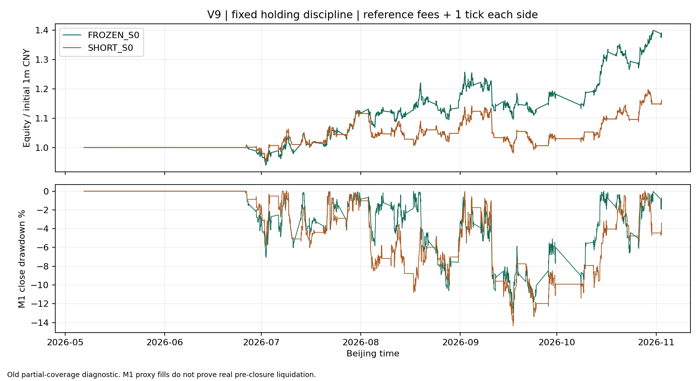

# V9：短线持仓纪律的代价与隔离独立入口

**用户确认的持仓纪律已落地并冻结。它在旧窗缩短了模型持仓、消除了模型跨休市敞口，但没有增强经济性或降低主情景回撤。独立检验仍未消耗，模拟盘继续暂缓。**

本轮基线 `be8bd9c`。唯一候选的规则、输入和执行代码在任何纪律版旧窗盈亏计算前，以 **`12dfca1`** 提交。只比较原 S0 与这一条纪律版 S0；四个成本情景沿用原登记，没有搜索其他持仓期限或退出阈值。V8旧账已经结项，原报告和账本未被本轮覆盖。

## 1．确认后的可执行规则

用户明确选择：允许普通隔夜；最迟在开仓后的**下一交易日日盘收盘前5分钟**开始清仓；周五日盘前清仓，周五夜盘禁开；长假前同样处理。不是按自然日加24小时，也不是持有5/10天。

实现读取独立交易日历的预期分钟及交易日归属：

- 每笔成交的 `entry_day` 决定 D+1。用该交易日日盘最后一个预期分钟，减5分钟得到截止；当前12品种正常日盘为14:55。
- 从预期日历寻找至少24小时的连续休市。清仓窗口从这次休市之前**最后一个日盘**收盘前5分钟开始，持续禁止新开直到真正的节后首段开盘。因此周五夜盘禁开，长假后的首个夜盘可以恢复。
- 每日日盘最后5分钟不新开；进入休市清仓区间时，跨小节待执行意图也被取消。待清仓敞口未处理完时禁止本品种重开。
- 止损、目标、趋势退出保持原规则。新模块 `ShortSwingAccount` 在隔离目录中扩展账户；冻结的 V8 引擎、核心和配置未修改。关闭持仓政策时，四个账户完整复现 V8 原 S0。
- 缺M1分钟，或明确的执行状态为停板无对手、缺报价、未成交时，**头寸和风险留在账上**，记录请求时刻、首次受阻时刻、尝试次数及首次模型可退出时刻。不能把未成交写成已清仓。合成用例包括周五无法退出、实际敞口仍跨过周末的情况。

**成交证据边界必须保留。** 旧缓存没有全期L1，本轮与基线一致采用M1开盘/价位代理；“没有提供盘口证据”不是“已证明可成交”。旧窗的零周末敞口是这个代理模型下的结果，不是实际委托已清仓证明。明确的 `NO_QUOTE / LIMIT_DOWN_NO_BUYER / UNFILLED` 状态会阻止模型平仓；接入真实来源时须提供这样的同时点状态，不得把缺失状态当成成交回报。本轮没有运行真实下单或模拟盘。

## 2．一次旧窗完整账户对照

同一份 `prepared.pkl`、原价/事实哈希和资金风险参数，按时间顺序运行两个账户。不是删除原来的12笔长仓。原 S0 的四个情景分别精确复现基线的笔数、平均R、期末损益与M1收盘回撤。

金额单位万元，包含期末未平估值；费用和滑点仍是参考假设。

| 情景 | 原 S0损益 | 纪律版损益 | 纪律版平均净R | 原 / 纪律版最大回撤 |
|---|---:|---:|---:|---:|
| 无费用、无滑点 | +89.21 | +65.87 | +0.1456 | 11.76% / 13.05% |
| 参考费用＋每边1 tick | +38.98 | **+16.15** | **+0.0060** | **13.00% / 14.36%** |
| 参考费用＋每边2 tick | +29.80 | **+5.52** | **−0.0591** | **15.31% / 16.93%** |
| 参考费用＋每边3 tick | +5.59 | **−4.25** | **−0.0938** | **22.68% / 20.45%** |

主情景纪律版已平446笔、期末未平4笔；原版440笔、未平3笔。期末损益减少 **228,284.99元**。提前退出会释放资金和仓位，后面的信号、手数和退出序列也会变化，不能把这项损益差完全归因于某几笔提前平仓。

### 持仓目标实现到哪里

| 主情景模型指标 | 原S0 | 纪律版S0 |
|---|---:|---:|
| 自然持仓中位数 | 9小时52分30秒 | 7小时7分30秒 |
| 最长自然持仓 | 16天4分钟 | **1天17小时55分钟** |
| ≥5自然天 / ≥10自然天 | 12 / 2笔 | **0 / 0笔** |
| 跨周末持仓身份数 | 55 | **0** |
| 跨长休市持仓身份数 | 10 | **0** |
| 纪律导致的主要退出原因 | 0 | **71笔** |

71笔中，29笔为下一交易日截止、42笔为休市前退出。跨周末和长假按**真实自然时间区间**与预期休市段比较，不能用 `entry_day == exit_day` 判断；两种跨休市计数可能包含同一持仓，不能直接相加成独立交易数。期末持仓仍单列估值，不因样本结束伪造清仓；未来截止不可由截断的日历推断。

主情景可按相同合约、方向、开仓时刻匹配到53个提前退出案例。其中27个减少了原亏损，24个截短原盈利，2个属于其他提前退出。按各自初始风险归一后的毛R差合计 **−7.6759R**；这是匹配开仓的价格路径比较，不是整个账户的因果收益分解，尤其不能忽略两组手数差异及新增/消失的机会。

鸡蛋 `jd2611` 的例子：同在9月29日13:30开仓，原版10月15日13:34退出，毛R约+1.9888；纪律版9月30日14:55退出，毛R约−0.2360。它量化了不承担国庆休市敞口的代价，不能据此回头调整这条已确认的纪律。

原始证据：[总表](../reports/v9_holding/decision_table.csv)、[持仓与休市敞口](../reports/v9_holding/holding_exposure.json)、[逐匹配案例](../reports/v9_holding/matched_early_exits.csv)、[分类摘要](../reports/v9_holding/early_exit_summary.json)。每组四情景逐笔、未平仓、开仓预算、失败退出和每日权益均在 `reports/v9_holding/`；完整M1权益与授权原件只留本机。

### 不确定性不等于持仓期限

保留旧窗全部 **121个交易日及零成交日**，按平仓日汇总净R和笔数；两个账户同步抽连续5/10日区块，重采样10,000次，种子20261104。原 S0 的区间复现评审口径；新增纪律版如下：

| 纪律版每笔净R | 点估计 | 5日块95%区间 | 10日块95%区间 |
|---|---:|---:|---:|
| 每边1 tick | +0.0060 | [−0.1143，+0.1363] | [−0.1108，+0.1131] |
| 每边2 tick | −0.0591 | [−0.1689，+0.0545] | [−0.1667，+0.0400] |

两种成本的区间均包含零。资金加权总额为正不能覆盖平均净R为负的警示；这也不是独立样本的淘汰/晋级裁决。**5/10日只用于统计分块；持仓纪律仍是D+1与休市前规则。** [完整条件于已发生账本的区间](../reports/v9_holding/block_uncertainty.json)。

## 3．隔离的独立回测入口

正式入口为 `python -m tools.short_swing_v9.entrypoint`，不使用会写旧 `reports/v8_*` 的旧窗入口。

- 独立协议、账户引擎、持仓政策、乘数/费用参数、输入包、独立日历与裁决代码均绑定哈希。真实运行只接受冻结协议；当前协议处于来源阻塞状态，入口在读取任何真实盈亏前拒绝执行。
- 预热可以更新指标、事实和趋势授权，**不运行预热交易账户**。评分视图按交易日归属切出完整日期，首个评分分钟账户现金100万元、持仓与待成交意图均为空；周五夜盘属于周一，但仍受周末禁开纪律约束。
- 每条评分实际腿先核对前置的连续完整预热；不是把1,200条M1当1,200根M15。缺日期、空回放、残缺15分钟桶、原价或引擎哈希不符均失败，且不生成成功结果。行情与事实覆盖完整而确实没有机会的情况单独处理。
- 重新核验的连续预热与当日合约身份会强制作用于评分视图，不直接信任缓存里的 `eligible=True`。缺口后的不合格阶段仍禁止新开，即使整段总覆盖率已达到门槛。
- 60个完整评分日按实际全池分钟和回放完整性核对，并剔除实际持仓跨缺口日；不能把82个登记日直接当82个完整日。所有82日仍保留在账本与统计中，不按结果删日。
- 日历须来自独立历史小节，另带至少2个后续交易日的**元数据**，用于末日真实D+1/休市截止判断；不读取受保护窗口的未来价格。末日未平仓单列估值。
- 输出必须是全新隔离目录，禁止写入任何旧报告目录。验证通过后才独占登记一次真实检验；重复执行不能只换 `--output` 逃过登记。中途失败的真实检验保留“已消耗/待复核”状态，不自动重开。
- 毛账本和1/2/3 tick情景分别完整运行；官方入口随后计算同步分块、集中度及预注册经济性裁决。只有所有条件通过，才得到“经济性条件通过、仍需执行验收”，从不自动开启下单。

合成数据已通过：预热尾部有信号但评分首分钟没有遗留意图；首日夜盘按交易日归属；实际纪律阻挡周五夜盘；末日未平仓估值；完整行情零信号可区分于空回放；篡改日期/残缺日历被拒；旧V8报告全部哈希不变；真实来源阻塞不产生结果也不消耗检验。

输入包规范：`input_lock.json + calendar.json + prepared.pkl`，源文件哈希、独立日历证明、映射时点依据、子池与费用/报价核验回执必须齐备。`prepared.pkl` 仅接受本机可信预处理产物，不直接加载供应商提供的pickle。真实数据仍未到位，真实输入包尚未构建和验收；合成演练不能替代这项准入。

```powershell
python -m tools.short_swing_v9.entrypoint --protocol tools/short_swing_v9/independent_registration.json --inputs <合格独立输入包> --output <全新目录> --study-dir data/cache/independent_v9_registry
```

当前执行会明确拒绝 `SOURCE_BLOCKED`。供应商资料到位后须先完成输入资格、子池和证据哈希冻结，再把状态变为数据已准入，不能通过改输出目录绕开。

## 4．独立窗口和数据线结项

独立窗口仍为2025-09-01至12-31的82个固定交易日，至少2个合格品种；95%分钟覆盖、80%可入场M15覆盖、每评分腿1,200根连续完整M15不变。用户确认的**15%最大M1收盘回撤**、60完整评分日、两组各100笔，以及主情景与2 tick下的正平均净R/正组合损益/分块区间下界正/剔除头号品种和前5笔后仍正，全部保留。

版本改为用户真正打算交易的短线版；简单入场对照也使用同样的持仓纪律。原 V8 登记保留，本轮新登记说明取代关系，**唯一独立检验未消耗**。[新冻结登记](../tools/short_swing_v9/independent_registration.json)、[准入状态](../reports/v9_holding/independent_admission.json)。

按用户要求，取数只做一次有交付物的权限核查。现有环境未发现BigQuant认证和DAI客户端，没有重复GM/EDB的拒绝请求，也没有注册或购买。已取得四所独立元数据日历与32条实际合约范围，但这些不是合格分钟原件或当时可知映射证明。[具体数据范围与授权决策单](32_V9_独立样本数据范围与授权决策单.md)。

## 5．本轮裁决和验收

**纪律符合已确认的持仓定位，但旧窗没有给出更厚的经济优势。** 不依据旧窗把期限放宽、改回原长仓版本或加第三个规则。冻结短线版供唯一独立验证；在来源、真实成本和独立结果齐备前不晋级模拟盘，也不把这次旧窗诊断称为独立成绩单。

本轮 **93项定向测试通过**：新增隔离入口/持仓/裁决30项，原相关63项；包括停板、缺报价、未成交保留风险的合成路径。四个原S0账户逐项复现基线；八账户资金对平，开仓风险和保证金守卫保持原规范。`production-code-review`复核了信号→开仓→截止请求→失败敞口→首次模型退出→现金/持仓账本的完整离线路径。真实盘口成交、broker恢复与拒撤重报不在通过范围内。

[本轮检查与版本指纹](../reports/v9_holding/review_checks.json)、[隐私检查](../reports/v9_holding/privacy_check.json)。

独立入口的预热资格修复未改动旧账账户、政策或数值。为使两条代码线可分别复核，旧账户登记的原运行快照保留在 [old_registration_run_snapshot.json](../reports/v9_holding/old_registration_run_snapshot.json)；当前旧窗重跑登记仅去掉它**没有调用**的独立入口文件哈希，所有实际账户/政策/费用/输入哈希保持原值。原输出仍指向首次运行的登记哈希，新独立协议则绑定修正后的入口，不混称为同一份代码指纹。


