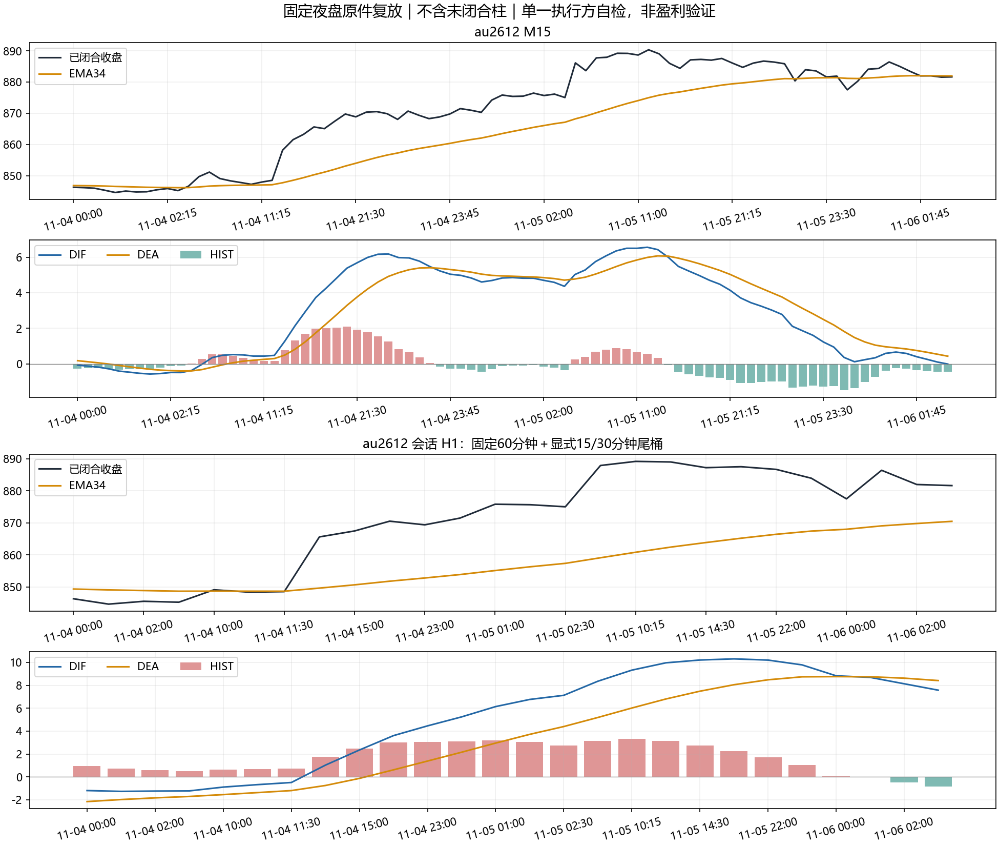

# 模拟核心 V2：修复、黄金原件复放与受控发布

基线：`dfed9d6a179ea60d441de0e022b801f750ec90f6`。修复分支：`codex/gm-core-correctness-v2`。执行与复核均为同一 AI 的自检，不冒充独立评审。研究基线、V10/V11 归档和唯一独立检验状态不变。

本轮修复了锚点出口、候选调度、H1 闭合与背驰失效记忆，并新增一个明确的模拟权限版本。模拟恢复的实际状态以同目录发布回执为准；测试与复放通过不能代替运行验收。

## 修复及回归

| 问题 | 修复 | 证据 |
|---|---|---|
| P0 失效锚点生成合法外观的止损 | 多头锚点必须低于入场，空头相反。核对实际合约、确认时刻、趋势段和结构身份；已突破、来源缺失、失去确认的结构不可沿用。原生模拟出口再次校验 | 886.72 / 934.44 反例拒绝；错误合约、段、确认时刻及缺证明均零意图；有效结构继续按原预算计算 |
| P0 本地忙碌永久丢候选 | 已完成回执先应用；退出/撤单优先；普通快照合并。从未提交的候选可在原截止内等待，重新检查报价、风险、持仓、停开、权限及原对手价边界 | 真实 `FiveRunner.cycle`＋`PaperEngine` 合成链通过；等待后只提交一次，过期/结构破坏/重启不补单，未知提交不重发 |
| P0 H1 桶随后扩张/拆分 | 固定会话边界；只用已闭合且完整的桶。日盘09:00、10:30、13:30起对齐60分钟，显式保留小节尾部15/30分钟短桶；黄金夜盘21点起对齐，02:00—02:30为短桶 | 每个前缀已发布桶不变；5/7根不扩张前桶，8根形成第二个固定桶；缺柱不能靠下一小节补满 |
| P1 背驰失效后复活 | 独立持久化事件失效墓碑，记录突破柱及原因。M15、闭合H1各自维护；重启保留。旧检查点要求归档后从原件重建 | 顶/底镜像突破、窗口移走突破柱、序列化重启后仍无效 |
| P1 背景等同开多许可 | 模拟专用 `CLOSED_FACTS_PERMISSION_V1`：背景、共享新开、技术退出、反向授权分别存证；A/B/C/D共用新开检查 | 四路径共享检查、多空镜像、技术退出不授权反手；方向、时钟和证明传到原生出口 |

H1 是明确登记的“固定会话60分钟＋短尾桶”，不能直接冒充图表软件的标准60分钟序列。每根事实记录来源柱、边界、时长、是否短桶、闭合/完整标志、known_at，以及趋势/入场两个截止。未满足完整性的桶不参与决策。

同一证据的 `evidence_created_at / first_eligible_at / decision_at / expires_at` 分开记录。M5 证据首次满足 M15 评估时登记可执行时间，截止固定为此后30秒；下一根M15不能续期。等待期间只接受首次可用对手价或更优的限价，不另加追价容忍度。结果未知的委托不属于可等待重试的候选。

## 单一权限版本

本轮未按亏损案例搜索阈值。规则在原件正式复放前写入 [冻结合同](48_模拟核心V2修复前冻结合同.md)，同一版本统一应用五品种。

- 背景仍由原趋势票数及 H1 否决产生。
- 新开要求 M15 收盘、斜率、MACD 与方向一致，反向 M15 背驰无效/不存在，闭合 H1 和交易时段来源可核。
- 连续两根已闭合 M15 同时处于均线反侧、MACD反向时，提议退出原方向。它不受 H1 维持背景的否决遮蔽，也不等于允许反手。
- 恢复新开必须重新满足全部共享条件，并出现仍在原有效期内的新证据；过期候选不重新激活。
- 已有硬止损、2R目标、D+1、周五与长假前清仓继续独立运行。风险预算、单手限制和组合上限不提高。

这是一项新的模拟行为版本，没有据此签发盈利或参数优越结论。

## 黄金原件复放

本机使用同一实际合约 `SHFE.au2612` 的授权缓存与真实分钟记录，从历史前缀逐根推进。只评价2026-11-05 21:00至11-06 02:30的指定事件，不重跑旧窗盈亏、不使用保护样本。22根M15与旧公开表逐根对齐，收盘、EMA34、ATR14一致，EMA/ATR最大绝对差为0。

| 时点（北京时间） | 旧背景行为 | V2 的动作权限 |
|---|---|---|
| 21:45 / 22:00 | B多头候选，本地忙碌；共用21:45 M5证据 | MACD不对齐且有效顶背驰，禁止新多；同证据不能在22:00续期 |
| 22:45 | 880.36，退势提案被H1否决 | 背景仍多；收盘反侧、MACD反向及顶背驰分别留证，禁新多；只累计第一根技术退出证据 |
| 00:00 / 00:15 | 两次VETO，背景仍多 | 00:15达到连续两根技术转弱，独立提议退出多仓，不自动开空 |
| 01:00 | 886.42，A候选；当时单手风险拦截 | 反弹没有使MACD恢复同向，顶背驰仍有效；A也被共享权限拦截 |
| 01:45—02:30 | 背景多，几次收盘略低于EMA34 | 新多禁止；02:00起再次满足技术退出条件，绝不把轻微跌破直接改成空头授权 |

22根的背景仍全部为bull，共享新开许可为0根。这个结果说明“上涨背景尚在”和“当前能开多”已经能同时准确表达；没有实际多仓时，技术退出只是提案，不能记作平仓成交。

### 两种背驰为何仍可同时有效

最新顶背驰的极值为11月5日10:15的890.88，11:00确认；底背驰极值为10月31日02:30的831.00，11月2日09:30确认。指定夜盘没有突破这两个失效边界。按既定“直到极值被突破”生命周期，两者同时留档/有效并非自动错误，也不能把底背驰解释为当前开多许可。

修复中保留了该定义：**发现新枢轴没有背驰，不等于旧事件已经失效**。首遍自检曾识别到一条多加的“新枢轴即撤销旧事件”条件，已删除并完整复放确认；未拿该首遍输出作最终裁决。没有证据证明当夜的两个事件曾复活，墓碑修复解决的是可复现的通用漏洞。

### 结构止损

934.44旧锚点不能再用于该夜盘多头。重建后的有效结构锚为11月4日21:45的867.04，A线890.88尚未突破；不擅自跳到更近枢轴。该距离可能超过原最大ATR或单手预算，仍须拒绝，不能通过放宽风险“修好”成交。原手工测试单属于其他模拟账户，不并入GM自然策略绩效。

### 同口径图与明细

[22根逐行差异表](../reports/paper_core_v2_20261106/gold_m15_comparison_v2.csv)；[机器摘要](../reports/paper_core_v2_20261106/replay_summary.json)。H1图中的EMA结构仍可偏多，同时MACD动能减弱；`bull_strong`只概括现有结构分类，不能单独解释为当前强势做多许可。

## 验证和发布边界

- 254项相关定向测试通过，另10项发布/停止/单次恢复门槛测试通过；一个既有protobuf弃用警告。语法与 `git diff --check` 通过。未宣称全仓研究消融测试全部跑完；宽范围消融测试已主动中止，不计通过数。
- 生成完整本地 `main.py`，在隔离目录及目标客户端通过源码、核心摘要和私有配置自检；旧原件、日志和凭据留本机。
- 客户端确认仅停止目标空仓期货模拟实例；平台停止回执确认空仓、无活动/未知委托；保留旧主程序、配置、状态回滚材料。
- 首次启动V2仍保持停开，五品种从原件重建。全部就绪、账户对平、通知健康、近期无故障后，才允许一次受控停机恢复；后续错误仍重新停开，巡检不自动解除。
- 通知进程由本策略持有并检查PID与健康时间；异常仅暂停新开，风险退出继续。既有11232拒绝和UNKNOWN_DELIVERY不删除、不冒充成功，也不盲重发。

代码回归证明的是执行合同，不是实际成交或止损收益。恢复后继续按5/20个交易日观察自然候选、唯一证据、实际委托/成交、退出余量、滑点与平台模拟费用；无信号时不降门槛凑交易。

## 11月6日续跑与通知问题的补充自检

上午旧趋势提醒的最后心跳为08:05:29，08:15:46的巡检已记录陈旧；旧PID随后核实不存在。09:15—10:15共有10张入场候选卡获得飞书`vendor_code=0`，但日盘没有生成趋势汇总卡。断点位于独立趋势任务，而非这一时段飞书发送通道全面不可用。旧任务退出的确切时刻、原因没有日志证据，保持UNKNOWN，不猜为网络故障。既有一条11232和两条投递未知与本次缺卡分开记录。

V2由主策略启动一次自己持有的趋势子进程，先要求五品种事实就绪，再核对PID和30秒内心跳；失效暂停新开并留告警，退出监督继续，不自动重启。提醒停发不能当作没有交易信号。正式恢复须核验实际闭合M15生成汇总卡及飞书回执，合成测试不能替代这一环。

11:11:31客户端停止目标空仓实例后，子进程已经退出，父进程仍驻留并占账户互斥锁。多进程队列退出等待是推断，未取得线程栈证明。已补充本实例队列的`cancel_join_thread/close`及停止后迟到回调屏蔽；真实再次停止时仍需确认父进程释放，不能绕过互斥锁启动第二控制器。

预热性能自检发现GM适配层将`pandas.Timestamp`带入核心。它的时间运算开销较高，现按既定`Bar`合同规范化为原生`datetime`；非整分钟拒绝，不截掉纳秒后冒充完整柱。五条真实原始种子共110,007根M1已逐根比较，数值、时钟和身份全部相同；未修改指标、阈值、持仓纪律或原件。种子路径、SHA256、截止随检查点持久化，续跑前证明已确认M15前缀精确相同。重启合并遇到已闭合原价修订即冻结，不重写旧事实。

13:12通过客户端续跑，保持暂停新开，沿用五个部分重建的V2事实簿。完整`main.py`包含194份源码，全部与研究分支及客户端展开文件一致；42项核心、执行和纪律文件摘要单列。追加61项定向检查通过（与前批有重叠，不相加冒充唯一用例数），覆盖种子持久化、原件哈希、停止清理、只读核仓时效及账户绑定、趋势提醒。语法和差异检查通过。当前真实恢复状态以[发布状态回执](../reports/paper_core_v2_20261106/release_state.json)为准；暂停预热不等于已经恢复受控新开。

### 受控新开恢复

五品种13:25前已全部就绪；13:45汇总卡在13:45:17生成并获飞书成功回执。下午14:00红枣D、豆粕C、鸡蛋C三条候选先排队，最终均明确终结为`BLOCKED / STOP_NEW_OPEN`，不是模拟柜台拒单，也不能据此宣称其余风控全部通过。它们已过原截止，不再补单。

客户端正常停止后，父进程与账户锁已释放。受控恢复工具另发现一处时钟校验错误：正常停止会一并停止提醒子进程，不能继续要求它在离线校验过程中更新心跳。现严格核验同一主策略持有的PID、启动至停止的时间顺序、停止前30秒内心跳和空仓停止回执；当前账户、行情与源码时效仍分别校验，不刷新旧时钟。24项发布回归通过，包括停前已陈旧、未来心跳、旧主策略心跳、错误PID和非空仓拒绝，单次授权不能重复使用。

14:11执行一次受控恢复，14:12新实例实际进入`NATURAL_SIGNAL_OBSERVATION`，五品种就绪、新开暂停为false、对账正常、无新增故障。单手、组合限额、原止损目标、D+1及周末清仓全部保留；后续故障仍重新暂停。没有人工信号，没有为补足成交下测试单。这证明恢复了观察自然执行的条件，不等于已经形成自然交易闭环或盈利证据。

交易用完整主程序仍为`a87668d3c8465a436887e3a54987e9652329abfa4057c827ccff5bdfbee00b8a`（LF SHA256），核心、执行及纪律42项与客户端一致。上述停止心跳修正仅作用于外部操作者发布工具，不是交易回调的热更新；恢复回执另记实际使用的发布工具摘要。194份全量相等的检查时间为13:15，在该工具修改之前，不把它冒充修改后的全仓相等证明。

另发现通知历史积压：13:24补发十张上午候选详情，13:36发出两张上午确认的M5背驰提醒。它们不是下午新机会；旧资料卡未生成有效结构计划，不可据此手工交易。该通知问题已在本机留证，待盘后统一修正启动游标与信号原始时间表达；不通过盘中修改交易参数来处理。

### 首次自然执行：排队已前进，尚未形成成交闭环

14:15鸡蛋C、红枣C两个自然候选曾遇到同一在途`snapshot`，通道释放后在原14:15:30截止前继续处理。这次操作类型有实时留痕，不用于倒推昨夜未记录的忙碌请求。鸡蛋最终为`STRUCTURAL_STOP_INVALID`；红枣14:15:21.661生成一手本地委托意图，未被忙碌永久丢弃。

但红枣仍没有柜台委托：报价事件时间14:15:19、本机收到14:15:21.139，原生出口完成核仓后该报价已超过3秒，返回`quote became stale before native submit`，明确尚未调用`order_volume`。`SUBMITTED`候选状态在此只表示本地RPC意图，不能记作柜台受理或成交。当前自然成交仍为0。

这一结果暴露了最终报价刷新/时延余量问题。盘后应在可信同合约来源上设计最终出口刷新及回归，同时保留3秒时效、原截止、价格边界、结构与账户风控；不得把放宽时效或盲重发当修复。交易继续依原规则运行，等待合法自然机会，不补发这笔过期信号。具体派生事实见[首轮前向执行摘要](../reports/paper_core_v2_20261106/first_forward_execution.json)，原始RPC及报价留本机。

14:00还新增两条候选终结卡11232拒绝和一条候选卡19006拒绝，不能只统计此前的一条11232。这与13:45趋势卡成功投递并存；提醒进程存活不代表每张卡均成功。失败回执保留，不盲重发，通知修复并入盘后统一方案。

## 首笔自然交易完整闭环与其它信号复盘

红枣`CZCE.CJ701`的14:30自然D信号在原截止前完成排队、柜台受理和一手成交，随后按周末清仓退出。没有人工信号、测试委托、加仓或盘中参数变更。

| 环节 | 事实（北京时间） |
|---|---|
| 信号／入队 | 14:30:00／14:30:04.891 |
| 本地开仓意图／平台开仓成交 | 14:30:20.485／14:30:20.803，买入1手6555 |
| 保护计划 | 止损6315，2R目标7035；初始风险1200元 |
| 周末退出触发 | 14:55:00.103，`PRE_LONG_CLOSURE_EXIT` |
| 平仓意图／平台平仓成交 | 14:55:09.626／14:55:09.837，卖平1手6545 |
| 柜台归零确认 | 14:55:11.069；余量0、活动委托0、账实一致 |
| 价差毛结果 | −50元，约−0.0417R；平台成交回报开平费用均为0，实际费用未核验 |

持仓24分49秒。按收到的轮询报价，持仓期间观察到的有利/不利浮动为+75/−100元，属于采样值，不能冒充完整逐笔极值。开仓比首次记录的卖一6560低1tick，成交与最终限价6555相同；仿真不能据此证明真实冲击成本。平台与本机时钟未独立校准，跨端时差只作为观察记录。

本地候选等待15.594秒，原30秒截止没有续期。日志中51条`BROKER_BUSY`和13条报价陈旧是同一候选的重复评估，不是64个机会；其中39次忙碌明确记录在途`snapshot`，其余上下文没有当前操作类型，不猜为snapshot。排队最终前进并成交，证明该样例没有永久丢弃。

退出触发至平仓发令9.523秒、至归零确认10.966秒，期间没有重复平仓成交；逐次未发令原因没有完整落盘，不能认定全部耗时来自某一原因。退出待完成、平仓成交、柜台确认已平三张卡均获飞书成功回执。截止展示仍只写D+1下周一，与实际更早的周末退出不一致，须补有效最早截止字段。

其它候选方面：14:30豆粕、鸡蛋用同根检查点及此前收到的报价复算，结构距离约6.30/10.24ATR，超过6ATR上限；这是复算解释，原拒绝事件没有保存完整报价与计算参数，不冒充原出口的精确快照。14:45鸡蛋仍为结构止损拦截；红枣D被冷却拦截，没有加仓。应补记录锚点、报价、ATR、缓冲、实际/上限距离和明确异常类型，不调整阈值去追求成交。

[完整闭环机器摘要](../reports/paper_core_v2_20261106/first_roundtrip.json)、[开平成交派生账本](../reports/paper_core_v2_20261106/first_roundtrip_fills.csv)、[候选最终结果](../reports/paper_core_v2_20261106/candidate_final_outcomes.csv)。原件和逐次观察样本留本机。两条自然成交回报只构成一笔完整交易，不作为盈利能力结论。

## 对新增风控建议的基线核对

本轮只评审建议，没有修改模拟风险参数或启动旧窗变体。

| 项目 | 当前实际模拟版本 | 对所提数值的判断 |
|---|---|---|
| 单笔风险 | 0.25%，每笔最多1手 | 提到0.5%—1%会放宽 |
| 日亏损 | 1%；交易日首个有效对账权益为基数，日内固定 | 并非缺失；改2%会放宽 |
| 账户回撤 | 持久化权益高水位回撤5%停止新开 | 8%/12%/15%分档晚于现有熔断；15%是旧独立检验预算 |
| 保证金／持仓 | 总保证金20%；组合最多2个持仓，同品种不加仓 | 隔夜30%—40%不能覆盖当前更低的总上限；不能把1手减为半手 |
| 技术退出 | 已接入闭合M15连续转弱退出，与背景翻向和H1否决分开 | 不再只有D+1或趋势翻向退出 |

1%日损和5%回撤经两个纯合成执行器探针验证会阻止新开，未给真实账户发送委托。需准确限定动作：现规则是停新开、继续原持仓退出监督，并不自动强平全部当日仓；`tick`也没有单凭`halt_reason`立即撤所有已受理开仓的条件，原10秒等待仍适用。若要改成更强的撤单/减仓熔断，须明确升级动作并补整链验收，不把现有门控描述成全部熔断动作已齐备。

确实尚缺连续亏损冷却、路径时间止损、移动/成本保护止损、独立隔夜跳空预算和多档预警。它们需要分别登记：连续亏损按完整已平交易及费用口径统计，持仓中的浮亏不计一笔连亏；多个熔断原因须持久化且互不覆盖；时间止损明确从成交还是首个完整M15计数、采用MFE还是收盘位移、R/ATR是否固定于入场；移动止损只能收紧，不能通过重算R美化结果。

首单在45分钟前已因周末清仓退出，因此拟议45分钟规则不会使它更早离场。覆盖入场和退出边缘分钟的26根M1最高6575，仍低于0.5R价位6675和1.1倍入场ATR价位约6609.12；这只是该笔适用性检查，不足以选择新退出参数。没有隔夜交易样本，不能由这笔决定普通隔夜的收益与尾部风险。

隔夜风险应以合约名义敞口、跳空/滑点压力金额及保证金变化联合约束；历史最大跳空不是未来最坏边界。止损触发也不保证在指定价成交，快速跳空可能在下一可见价格执行，[CFTC工作人员研究](https://www.cftc.gov/sites/default/files/Stoploss_final_ada.pdf)有相应说明，其美国品种结果不直接提供国内品种阈值。[上期所风险控制规则](https://www.shfe.cn/regulation/exchangerules/otherrules/202606/t20260622_832192.html)也明确保证金制度与风险调整机制。2%、连亏3笔、30%—40%等数值未获本项目证据支持，不登记为统一行业标准；文中TOCOM论文未给可定位标识，本轮不据此定参。

旧成交按“最终是否隔夜”分组只能做描述，不能作为隔夜政策的因果增量。若研究普通隔夜，应在固定入口、同一资金/风控/费用下重新回放两套完整账户；不因新供应商或新分组就把已观察旧窗变成独立样本。下一步先补最终报价时钟、退出等待原因、有效清仓截止和通知游标，再为新增退出/隔夜机制单独冻结版本。当前0.25%/1%/5%/20%限额与周末、长假清仓保持不变。

建议核对的机器回执见[风险建议差异表](../reports/paper_core_v2_20261106/risk_proposal_review.json)。当前止损/目标由本机执行器监控，不是已挂在柜台的常驻保护单；可用行情、进程存活、退出发令及余量对账仍是风险兑现的前提。
